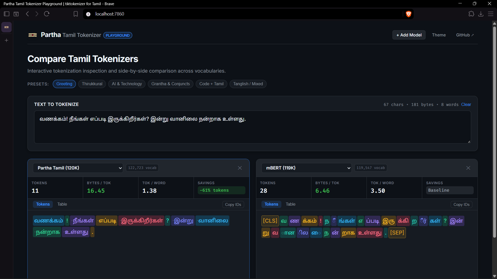

# Partha Tamil Tokenizer

A BPE tokenizer library for Tamil text, written in Rust.
It trains on custom Tamil corpora, encodes quickly, and exports to Hugging Face format without changing token IDs.
On the same 20M-token pretraining budget it is 10.1-10.2% better than `indictok-256k` and 36.7-36.9% better than mBERT in bits per byte on Tamil wiki text, and it is 16.5 points more accurate on six-class Tamil news classification.

[](https://partha.isroot.in/)
[](https://huggingface.co/barryallen16/partha-tamil-tokenizer)



Try the interactive playground live at [partha.isroot.in](https://partha.isroot.in/).
It compares tokenization, byte metrics, and token-count savings against OpenAI, Gemma 4, Llama 4, and mBERT in real time.

## Features

- Tamil-aware base vocabulary of 1,135 tokens with no training: 256 byte tokens, 12 independent vowels, 23 standalone consonants, 276 consonant+vowel-sign clusters (including Grantha `ஜ ஶ ஷ ஸ ஹ`), 4 special characters (`ஃ ஂ ௐ ௗ`), 15 compound ligatures (`க்ஷ`, `ஸ்ரீ`), 528 conjunct stems, 10 Tamil digits, and 11 extra characters.
- The conjunct stems are what moved compression.
  Tamil joins consonants constantly (`க்ஷ`, `ஸ்ரீ`, `க்ட`, `ண்ட`), and each one used to cost 3-4 tokens.
- Training runs in parallel through [rayon](https://docs.rs/rayon) and uses packed pair storage plus a priority queue for merge selection.
- Encoding uses a packed merge table with a per-pair rule cache, so a pair is looked up once per chunk instead of once per merge.
- `encode_batch` and `encode_ordinary_batch` split a document set across all cores.
- `export_hf` writes `tokenizer.json`, `tokenizer_config.json`, `special_tokens_map.json`, `vocab.json`, and `merges.txt`.
  The output is checked against Python `tokenizers` and `transformers`.
- The Rust encoder and the Hugging Face export read the same vocabulary and merge list, so they emit the same token IDs for the same text.
- Special tokens cover BOS/EOS, language tags, question and answer markers, and 100 reserved slots in an o200k-style layout.
- Byte mapping uses the exact GPT-2 byte-to-unicode table, so the export matches Hugging Face's `ByteLevel`.

## Training datasets

The tokenizer trains on a balanced mixture of three complementary corpora:

- **Tamil Wikipedia**: Formal encyclopedia text providing core orthographic coverage and domain terminology.
- **IndicCorp v2**: Multi-source Tamil news and web crawl articles providing modern written prose.
- **YouTube Video Transcripts**: 1,400 conversational Tamil video transcripts (896,641 lines, 71 MB) sourced from `sivabharani-comments`.
  This adds spoken Tamil patterns and colloquial vocabulary absent from written publications.

Corpus preparation and mixing are handled by `scripts/prepare_corpus.py`.

## Quickstart

### Python

```python
from transformers import AutoTokenizer

tok = AutoTokenizer.from_pretrained("barryallen16/partha-tamil-tokenizer")
tok.encode("வணக்கம் இது தமிழ்").input_ids
```

The 120K model is at the repository root; the 30K model is in `tamil_tokenizer_wiki_hf/`:

```python
tok_30k = AutoTokenizer.from_pretrained(
    "barryallen16/partha-tamil-tokenizer", subfolder="tamil_tokenizer_wiki_hf"
)
```

### CLI

The unified binary supports training, encoding, decoding, evaluation, and export:

```bash
# Train on a corpus with a target merge count
cargo run --release -- train ./data/tamil_corpus.txt 50000 ./output/tamil_tokenizer.json

# Encode text to token IDs
cargo run --release -- encode ./output/tamil_tokenizer.json "வணக்கம்!"

# Decode token IDs back to text
cargo run --release -- decode ./output/tamil_tokenizer.json 224 174 181

# Interactive REPL
cargo run --release -- repl ./output/tamil_tokenizer.json

# Score compression and throughput in-process
cargo run --release -- score ./output/tamil_tokenizer.json ./data/tamil_corpus.txt sample

# Export Hugging Face artifacts
cargo run --release -- export ./output/tamil_tokenizer.json ./output/hf_export
```

### Rust library API

```rust
use tamil_tokenizer::{load_tokenizer, FastBPEEncoder, OptimizedBPETrainer, TamilTokenizer};

// Train
let base = TamilTokenizer::new();
let mut trainer = OptimizedBPETrainer::new(base.vocab);
trainer.initialize_from_corpus("./data/tamil_corpus.txt")?;
trainer.train(50000);
trainer.save_tokenizer_with_reserved_tokens("./output/tamil_tokenizer.json")?;

// Encode and decode
let (vocab, merges) = load_tokenizer("./output/tamil_tokenizer.json")?;
let encoder = FastBPEEncoder::new_with_merges(vocab, &merges)?;

let token_ids = encoder.encode_ordinary("வணக்கம்!");
let decoded = encoder.decode(&token_ids);
assert_eq!(decoded, "வணக்கம்!");
```

### Playground

Launch the interactive tokenizer comparison playground locally:

```bash
uv run python playground/server.py
```

Then open `http://127.0.0.1:7860` in your browser.
You can also access the hosted version directly at [partha.isroot.in](https://partha.isroot.in/).

## Results

| test | this repo | `indictok-256k` | mBERT |
|---|---:|---:|---:|
| bits/byte, wiki (lower is better) | **0.9193** | 1.0123 | 1.2575 |
| bits/byte, transcripts (lower is better) | **0.9150** | 0.9877 | 1.3266 |
| Tamil news accuracy, 6 classes | **0.5583** | 0.3932 | 0.3936 |

Bold marks the best score in each row.
Equal-token budget, three seeds.
Full tables, confidence intervals, per-class scores, and caveats are in [docs/RESULTS.md](docs/RESULTS.md).

### Real-world comparison against foundation models

Measured across 21.0 MB of text (4,000 documents, 875,413 words, 20,990,118 UTF-8 bytes) from two foundation corpora: `ai4bharat/sangraha` and `mozhi-ai/tamil-corpus`.
Benchmarked on Google Colab across all 12 playground tokenizers using `scripts/colab_benchmark.py`.

| Rank | Model | Category | Tokens | Bytes / Token | Tokens / Word | Savings vs OpenAI |
|:---:|:---|:---|---:|---:|---:|---:|
| **1** | **Partha Tamil (120K)** | Partha | **1,417,440** | **14.81** | **1.62** | **+50.2%** |
| 2 | AI4Bharat IndicBERTv2 (256K) | Indic LLMs | 1,562,846 | 13.43 | 1.79 | +45.1% |
| **3** | **Partha Tamil (30K)** | Partha | **1,646,352** | **12.75** | **1.88** | **+42.2%** |
| 4 | Sarvam-1 (68K) | Indic LLMs | 2,016,655 | 10.41 | 2.30 | +29.2% |
| 5 | Google Gemma 4 (262K) | Open LLMs | 2,243,822 | 9.35 | 2.56 | +21.2% |
| 6 | Sarvam AI 105B (262K) | Indic LLMs | 2,248,024 | 9.34 | 2.57 | +21.0% |
| 7 | OpenAI GPT-5.x & o1/3 (o200k_base) | OpenAI | 2,846,929 | 7.37 | 3.25 | baseline |
| 8 | mBERT (119K) | Baselines | 3,124,699 | 6.72 | 3.57 | -9.8% |
| 9 | Alibaba Qwen 3.8 (248K) | Open LLMs | 3,818,285 | 5.50 | 4.36 | -34.1% |
| 10 | Meta Llama 4 (201K) | Open LLMs | 5,223,528 | 4.02 | 5.97 | -83.5% |
| 11 | Meta Muse Glimmer (202K) | Open LLMs | 5,223,528 | 4.02 | 5.97 | -83.5% |
| 12 | OpenAI GPT-4 & 3.5 (legacy cl100k) | OpenAI | 10,308,009 | 2.04 | 11.78 | -262.1% |

General foundation models suffer from a heavy Tamil token tax because their vocabularies treat Tamil as fallback bytes.
Partha 120K tokenizes real-world Tamil at 1.62 tokens per word, cutting API cost and context consumption by 50.2% compared to OpenAI GPT-5.x / o1.
Even the compact 30K Partha model outperforms models with 200K+ vocabularies like Gemma 4, Sarvam 105B, and OpenAI's 200K models.

## The published models

The [Hub repository](https://huggingface.co/barryallen16/partha-tamil-tokenizer) publishes two models.
Both are retrained as v4 with a dummy prefix on every training line.
The prefix closes the line-initial word split and is worth 0.5-1.3% depending on merge budget.

| file | merges | vocab | wiki B/tok | IndicCorp B/tok |
|---|---:|---:|---:|---:|
| `tamil_tokenizer_wiki.json` | 30,000 | 31,793 | 13.115 | 13.053 |
| `tamil_tokenizer_wiki_120k_mixed.json` | 120,000 | 122,723 | 14.720 | 16.251 |

The 120K mixed model is the default.
It ties the best specialist on each domain.
Going from 30K to 120K merges costs about 11% in throughput.
Use the 30K model when artifact size matters more than sequence length.

## Documentation

- [Results](docs/RESULTS.md): full tables, confidence intervals, byte-matched controls, and caveats.
- [Hugging Face model](https://huggingface.co/barryallen16/partha-tamil-tokenizer): the published 30K and 120K tokenizers and the training corpora.
